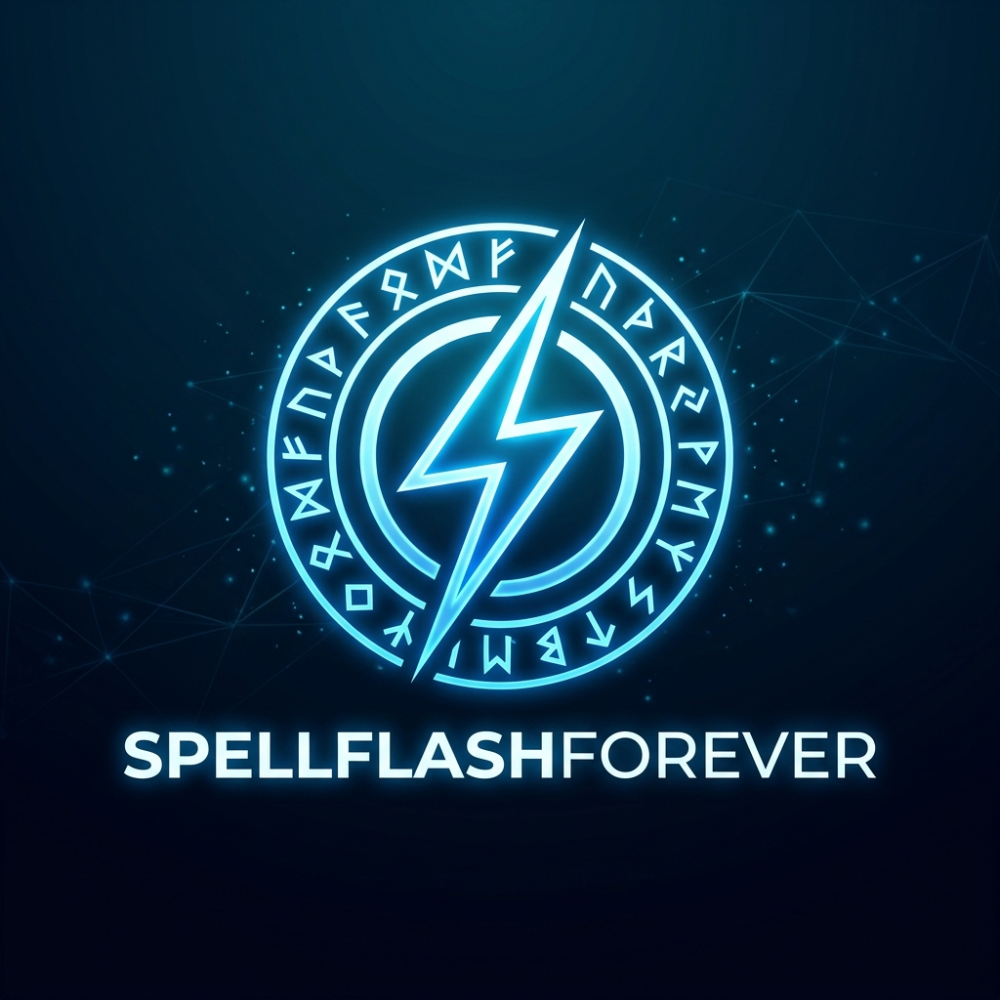

# SpellFlash Forever

  

> **[English](#english)** · **[Português (ptBR)](#português-ptbr)**

---

## English

Rotation assistant for **WoW Forever** (Interface `16001`, vanilla content on a modern
engine). Every 0.2s the addon evaluates your spec, talents, target, mana, range and
combat state — and makes **the action bar button for the ability you should use right
now flash**, with colors per function (damage, AoE, interrupt, defensive, utility).

It does **not** press the key for you — it just flashes the button. You stay in
control.

### What's new in 1.7.0

- **General tab settings now persist across sessions.** The flash Size/Brightness sliders were moved into the same proven storage used by every other option, so your setup survives `/reload` and relogs.
- **New option — "Border width"** (General tab): in the **border glow** mode, increase the frame width in pixels (0–60, default 12; 0 = old look).
- **All 6 TOCs declare Version 1.7.0.** Previously: full bilingual support, all buffs suggested correctly after cast, Tauren's War Stomp as last-resort interrupt.

### Modules

| Folder | Class | Highlights |
|---|---|---|
| `SpellFlashForever/` | Core (SpellFlashForever) | Suggestion driver, combat aura beliefs, per-character visual rotation editor (`/sf`), key button, minimap button |
| `SpellFlash_Hunter/` | Hunter | BM / MM / SV (Survival) |
| `SpellFlash_Shaman/` | Shaman | Elemental (focus) and Enhancement |
| `SpellFlash_Warrior/` | Warrior | Arms / Fury / Protection |
| `SpellFlash_Druid/` | Druid | Cat / Bear / Balance (best-effort) |
| `SpellFlash_Paladin/` | Paladin | Protection (tank) and Retribution (DPS) |

### Requirements

- WoW Forever, Interface **16001**.
- Any locale — the addon auto-detects ptBR (Portuguese) and English (all others).
- All 6 addon folders copied into `Interface\AddOns\`.

### Installation

1. Download the ZIP from the latest [Release](../../releases).
2. Extract it into `World of Warcraft\_forever_\Interface\AddOns\`
   (the 6 folders must sit directly inside `AddOns`).
3. Log in or `/reload`, then type `/sf`.

### Commands

| Command | Function |
|---|---|
| `/sf` | Open/close the configuration window (tabs: General, **About**, and each class) |
| `/sf status` | Module status |
| `/sfminimap` | Show/hide the minimap button |
| `/sfcd` | Cooldown diagnostics board |
| `/sfkey` | Toggle the key button (shows the key for the flashing ability) |

### Rotation editor

Each class tab has a **"Custom rotation"** section: enable/disable nodes, reorder
(▲▼), add conditions per ability, **Save** (per character) and **Share** (export as
`!SFROT-1!...` string). "Restore default" reverts to the guide.

### Credits

- **Marcus** — creation and project direction.
- **Inkling 2 Small Free (OpenCode)** — technology and development partner.
- Original SpellFlash (WotLK 3.3.5a): Exalter (Druid), BigRedBrent (Warrior),
  SF Community (Shaman) and the SpellFlash community. This is a port/derivative,
  with a deep architecture and rotation rework for the Forever.

### License

[MIT](LICENSE) — see the `LICENSE` file.

---

## Português (ptBR)

Assistente de rotação para o **WoW Forever** (Interface `16001`, conteúdo vanilla em
engine moderna). A cada 0,2 s o addon avalia sua spec, seus talentos, seu alvo, sua
mana, seu alcance e o estado do combate — e faz **piscar na barra de ação a
habilidade que você deveria usar agora**, com cores por função (dano, AoE,
interrupção, defensivo, utilidade).

Ele **não aperta a tecla por você** — apenas acende o botão. Quem joga é você.

### Novidades na 1.7.0

- **As preferências da aba Geral agora persistem entre sessões.** Os sliders de Tamanho/Brilho do Flash passaram para a mesma coleção comprovadamente persistente dos demais ajustes — nada mais some no `/reload` ou no relog.
- **Nova opção — "Largura da moldura"** (aba Geral): no modo **brilho de contorno**, aumente a largura da moldura em pixels (0–60, padrão 12; 0 = visual antigo).
- **As 6 TOCs declaram a Versão 1.7.0.** Antes disso: suporte bilíngue completo, buffs sugeridos corretamente após o cast, Pisada de Guerra Tauren como interrupção de último recurso.

### Módulos

| Pasta | Classe | Destaque |
|---|---|---|
| `SpellFlashForever/` | Core (SpellFlashForever) | Driver de sugestões, crenças de auras em combate, editor visual de rotação por personagem (`/sf`), botão de tecla, botão de minimapa |
| `SpellFlash_Hunter/` | Hunter | BM / MM / SV (Survival) |
| `SpellFlash_Shaman/` | Shaman | Elemental (foco) e Enhancement |
| `SpellFlash_Warrior/` | Warrior | Arms / Fury / Protection |
| `SpellFlash_Druid/` | Druid | Cat / Bear / Balance (best-effort) |
| `SpellFlash_Paladin/` | Paladin | Protection (tank) e Retribution (DPS) |

### Requisitos

- WoW Forever, Interface **16001**.
- Qualquer locale — o addon detecta ptBR (português) e inglês (todos os outros).
- As 6 pastas do addon copiadas para `Interface\AddOns\`.

### Instalação

1. Baixe o ZIP da última [Release](../../releases).
2. Descompacte em `World of Warcraft\_forever_\Interface\AddOns\`
   (as 6 pastas devem ficar direto dentro de `AddOns`).
3. Entre no jogo ou `/reload` e use `/sf`.

### Comandos

| Comando | Função |
|---|---|
| `/sf` | Abre/fecha o menu de configuração (abas: Geral, **Sobre**, e cada classe) |
| `/sf status` | Status do módulo carregado |
| `/sfminimap` | Mostra/esconde o botão no minimapa |
| `/sfcd` | Quadro de diagnóstico de cooldowns |
| `/sfkey` | Liga/desliga o botão de tecla (mostra a tecla da habilidade acesa) |

### Editor de rotação

Cada aba de classe tem a seção **"Rotação personalizada"**: ligue/desligue nós,
reordene (▲▼), adicione condições por habilidade, **Gravar** (por personagem) e
**Compartilhar** (exportar como string `!SFROT-1!...`). "Restaurar rotação padrão"
volta ao guia.

### Créditos

- **Marcus** — criação e direção do projeto.
- **Inkling 2 Small Free (OpenCode)** — parceiro de tecnologia e desenvolvimento.
- SpellFlash original (WotLK 3.3.5a): Exalter (Druid), BigRedBrent (Warrior),
  SF Community (Shaman) e a comunidade SpellFlash. Este projeto é um port/derivado,
  com profundo retrabalho de arquitetura e de rotação para o Forever.

### Licença

[MIT](LICENSE) — ver o arquivo `LICENSE`.
